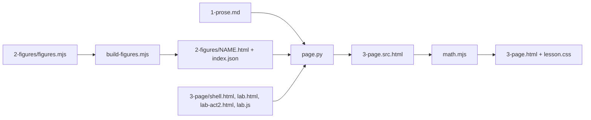

# Lesson kit

Shared figure primitives and the page build for every lesson in this series. Nothing here is lesson-specific: a lesson brings its own figures, lab and shell, and the kit turns them into `3-page/3-page.html`.



## Files

| File | Job |
|---|---|
| `fig.mjs` | SVG primitives as pure functions returning strings. Runs in node (figures) and in the browser (labs that want SVG). |
| `fig.css` | Figure styles, the CSS-only motion classes and the wide/phone switch. Colors come only from the `lesson.css` tokens. |
| `page.css` | Page components shared by every lesson: prose blocks, tables, questions, meters, the locked working. |
| `page.js` | Page runtime: holds each animated figure at its first frame until it is on screen, plays it once, adds "Replay"; unlocks the working when a lab reports it is solved. Plays nothing under reduced motion. |
| `lab.js` | `window.Kit` for labs: prediction questions, meters, canvas stage, pen, 30 fps loop, WAV parser, 8,000 samples/s player, tone sizes from a block of samples. |
| `build-figures.mjs` | Writes `NAME.html` (wide) and `NAME.phone.html` (phone) per figure, each a standalone diagram that passes diagram-design's `self_check.py` and `verify-geometry.py`, plus `index.json` with captions. |
| `page.py` | Builds the page and runs the build checks. |
| `demo/` | One figure using the primitives lesson 1 does not: wheel, tip-to-tail arrows, gain curve. |

## A lesson's folder

```
NN-slug/
  1-prose.md                 [[diagram:NAME]], [[lab]], [[lab-act2]] slots on their own lines
  2-figures/figures.mjs      export default k => [ { name, w, h, title, desc, caption, steps, body } ]
  3-page/shell.html          head, header, footer, <!--BODY--> and the directives below
  3-page/lab.html            one file per non-figure slot, named after the slot
  3-page/lab.js              the lab's own script
  3-page/build.py            three lines, below
```

```python
import sys
from pathlib import Path

sys.path.insert(0, str(Path(__file__).resolve().parents[2] / "_kit"))
import page

ok = page.build(
    Path(__file__).resolve().parents[1],
    append={"what-the-booster-breaks": "systems"},
    working=[{"section": "your-turn", "from": "Multiply 0.5 by 4", "through": 'id="figure-fix"', "unlock": "act2"}],
)
sys.exit(0 if ok else 1)
```

`still_text={moving: resting}` swaps a prose phrase such as "watch the figure build" for its still wording under reduced motion. `append` adds `3-page/NAME.html` at the end of a section, for a mini-lab that must come after the terms it uses. `working` locks the blocks of a section, from the one containing `from` through the one containing `through`, behind "Show the working" until a lab fires `document.dispatchEvent(new CustomEvent('k:solved', { detail: 'act2' }))`. Use it whenever the prose works out a lab question's answer above the lab, and list every block that gives the answer away, including ones after the lab. Several entries can share one `unlock` key. Optional keys: `button`, the locked button's label (default "Show the working (opens after the lab)"), and `opened`, the note shown once it unlocks (default "You have fixed it, so this part is open to read."); set both when a question, not a fix, opens the box.

Run `python3 3-page/build.py`. It rebuilds the figures, fills the slots, renders the math, copies `lesson.css` next to the page and prints any problem: an em dash, an unfilled slot or directive, a duplicate id, a script that does not parse, a slot with no file. Exit code 1 means a problem.

Shell directives: `<!--BODY-->` the prose, `<!--KIT:fig.css-->`, `<!--KIT:page.css-->`, `<!--KIT:lab.js-->`, `<!--KIT:page.js-->` kit files, `<!--FILE:lab.js-->` a file in `3-page/`, `<!--BASE64:call-8k.wav-->` a file as base64. The shell has no doctype; the build adds `<!doctype html>` and `<html lang="en">` so the page opens from disk.

## Figures

```js
export default k => [{
  name: 'clip', w: 720, h: 340, phone: { w: 360, h: 560 }, steps: 3,
  title: 'The booster clips the loud caller',
  desc: 'One sentence about the content, for the screen reader.',
  caption: 'One or two sentences under the figure on the page.',
  body: (k, L) => {
    const P = L.phone ? k.plot({ x: 44, y: 76, w: 296, h: 170, xs: [-0.5, 7.5], ys: [-2.25, 2.25] })
                      : k.plot({ x: 70, y: 70, w: 260, h: 210, xs: [-0.5, 7.5], ys: [-2.25, 2.25] });
    return [k.band(P, -1, 1), k.step(1, 'the quiet caller grows by 4', k.stems(P, pts))];
  },
}];
```

Then `node _kit/build-figures.mjs NN-slug/2-figures/figures.mjs [name]`.

`body(k, L)` runs once per layout. `L` is `{ W, H, phone, slug }`; pass `L.slug` to `arrow` and `legend` and use `url(#${L.slug}-hatch)` so ids never clash. Figures scale to the column: there is no minimum width. Give every figure a `phone` layout (360 wide): stack side-by-side panels, shorten labels, drop numbers that would touch. On the page the phone layout shows when the column is 600 px or narrower, so nothing scrolls sideways. A figure with no `phone` scales down as one picture; only do that when its smallest text stays readable at 360 px.

Primitives: `plot` (data to pixels), `axes`, `band`, `curve`, `stems`, `bars`, `gainCurve`, `wheel` (unit circle with a dot turning counter-clockwise `stepDeg` per sample), `vectors` (arrows tip to tail), `arrow` (orthogonal connector), `legend` (a horizontal or stacked key), `box`, `text`, `masked` (text on a paper plate), `check`, `cross`, `line`, `rect`, `circle`, `path`, `g`, `step`. Helpers: `fmt` (true minus sign), `hz`, `deg`, `cosd`, `sind`, `range`.

## Visual code

Every lesson uses the same marks for the same meaning, so a reader who learned them once can read every figure.

| Mark | Means | Never |
|---|---|---|
| ink, solid | the signal or the value as it is | |
| `-soft`, dashed | context: the input, a reference, what was asked for | the result |
| `-input` (teal) | what the reader controls in a lab, or a given starting value | decoration |
| `-accent` (coral) | the one result to notice: the cut sample, the new tone | more than two things per figure |
| hatching | made by the system, not in the input | a tone the caller said, headroom, a highlight |
| tinted row or panel | the answer among options | a control |
| tick and cross | a rule passes or fails | alone: always with a word or number |

- One number precision per figure family: 2 decimals, unless the prose quotes more (1.207, 0.854); then use the prose's precision for that family throughout the figure. Leave tiny bars unlabelled and say so in one line.
- A meter says its full scale (`0%` to `40%` under the bar) and says "past the bar" when the value is beyond it.
- A static figure never looks like a control: no slider tracks, handles or button-shaped boxes. Show a setting as a label and value.
- When the prose says a figure does something ("the curve fades"), the animation does exactly that.

## Questions in a lab

`Kit.ask(el, { question, options: [[value, label], ...], right, hints: { value: hint }, explain, onSolved, focusAfter })`

- A wrong answer stays on the same question, greys that option out, says "Not quite.", gives its hint, and moves focus to the next option.
- The right answer, or "Show me the answer", shows the answer with `explain` next to the question, disables the options, and moves focus to `focusAfter()` or the feedback line. Focus never falls to the page body.
- Act 2 never asks the learner to compute the fix. Its prediction is about an outcome (what the fix will cost, which caller moves, what you will hear), and the learner finds the fix by acting on the control, guided by feedback that names each wrong setting. Every "Try another" case has its answer well inside the control's range, never at an end, so the learner can overshoot both ways.
- No question's answer may appear in the page above it. If the prose works it out first, lock that part with `working`, or put the lab before it with `append`.

`Kit.meter(el, value, { max = 0.4, known = true })` fills a `.k-meter` bar and writes its number.

### Motion

Any element can take `anim: { k, d, len, ...vars }`: `k` is `in`, `fade` (from `o0`), `flash` (visible only while it plays), `move` (from `dx`, `dy`), `scale` (from `sx`, `sy`), `turn` (from `r0`, in `steps`) or `draw` (stroke a path). `d` and `len` count steps of `--k-step` (650 ms). The source is the final frame, so reduced motion, print and no-JS show the finished picture with no extra work. Wrap the semantic parts in `k.step(n, label, ...)`: at most 8 steps, 12 items, two per step, which the build enforces to match diagram-design's motion budget.

## Labs

```js
const stage = Kit.stage(canvas, s => { s.pen.line(pts, s.c.ink, 1.5); }, { height: w => (w < 560 ? 320 : 260) });
const audio = Kit.player({ rate: 8000, gain: 0.3, onChange: on => { play.textContent = on ? 'Stop' : 'Play'; } });
audio.play(() => samplesAt8k);
audio.refresh();
const voice = Kit.wav(window.LESSON_CALL);
const sizes = Kit.tones(block, 8000);
```

`stage` redraws on resize and theme change and reads colors from the tokens. `player` builds an `AudioBuffer` at the lesson's rate, so no node resamples the lesson's own arithmetic; it loops, and `refresh` restarts at the same offset. Starting any player stops every other player on the page. Start it only from a click. `Kit.loop(root, tick)` gives a 30 fps loop that stops off screen, when the tab is hidden and under reduced motion.

## Credits

`lab.js` adapts the canvas grammar of the iwrzwr visual archive's Sample Hold Ladder study (MIT); keep its notice, and credit the study in the page footer.
